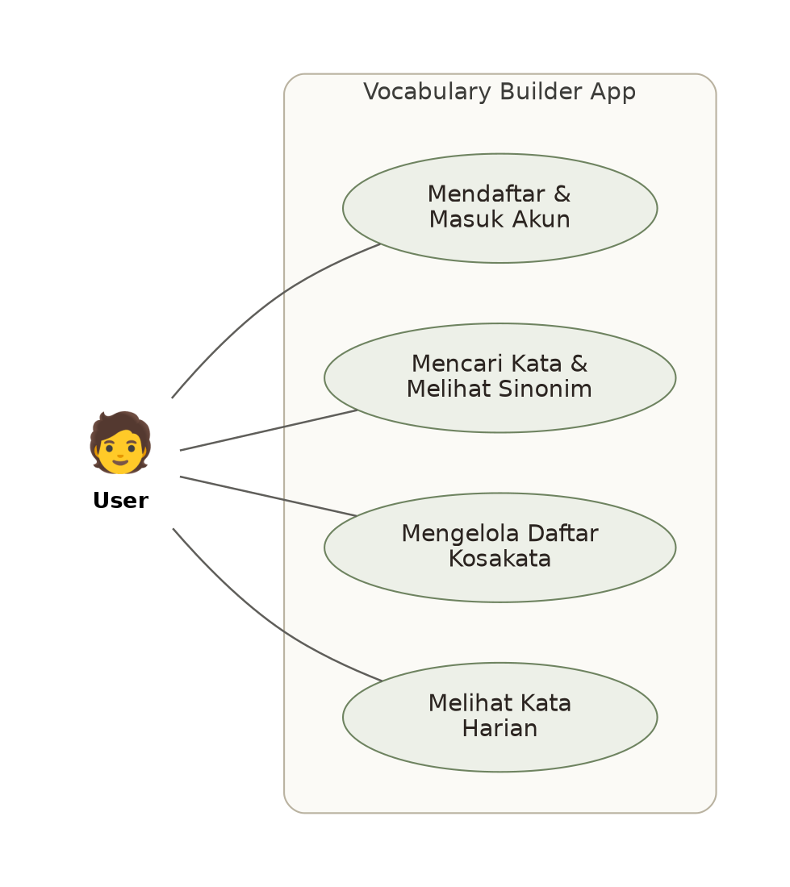
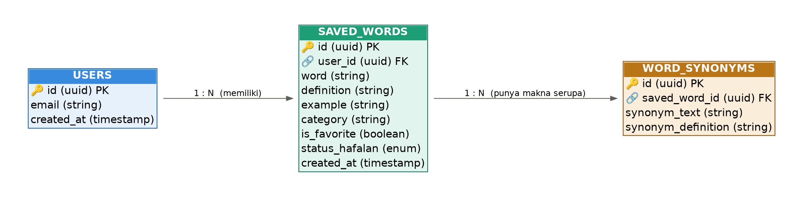

<div align="center">

# 🇬🇧 Britishly

### Bangun kosakata bahasa Inggrismu — satu kata setiap hari.

*Cari kata. Temukan makna serupa. Simpan. Kuasai.*

<br>


</div>

---

## ✨ Kenapa Britishly?

Belajar bahasa Inggris sering mentok di hal yang sama: **kamu tahu satu kata, tapi cuma satu.**
Mau bilang *"senang"*, yang keluar cuma `happy`. Padahal ada `delighted`, `thrilled`, `content`, `over the moon` — masing-masing punya rasa yang berbeda.

Britishly bikin kamu berhenti mengulang kata yang itu-itu saja.

Setiap kali kamu mencari satu kata, Britishly langsung menunjukkan **kata-kata lain yang maknanya mirip** — lengkap dengan definisi, cara baca (IPA), dan contoh kalimat. Pilih mana yang mau disimpan, kelompokkan sesuai kebutuhan (Travel, Bisnis, Sehari-hari), dan bangun kamus pribadimu sendiri.

> 🎯 Bukan sekadar aplikasi kamus. Ini aplikasi **membangun kosakata**.

---

## 🎯 Fitur Utama

| | Fitur | Deskripsi |
|:--:|---|---|
| 🔍 | **Cari Kata Instan** | Ketik kata apa pun dalam bahasa Inggris — dapatkan definisi, pelafalan (IPA), jenis kata, dan contoh kalimat |
| 🔗 | **Temukan Makna Serupa** | Lihat daftar kata dan ekspresi lain yang maknanya mirip. Pilih yang mau ikut disimpan |
| 💾 | **Kamus Pribadi** | Simpan kata utama beserta sinonim pilihanmu sebagai satu grup yang rapi |
| 🏷️ | **Kategori** | Kelompokkan kosakata: Travel, Bisnis, Sehari-hari, atau sesuai kebutuhanmu |
| 📈 | **Status Hafalan** | Tandai tiap kata: *belum* → *sedang* → *sudah*. Progresmu terlihat nyata |
| ⭐ | **Favorit** | Tandai kata penting supaya gampang ditemukan lagi |
| 🔥 | **Kata Hari Ini + Streak** | Satu kata baru tiap hari, plus penghitung hari beruntun supaya kamu konsisten |
| 🔐 | **Akun Pribadi** | Kosakatamu tersimpan aman di akunmu sendiri — bisa diakses dari mana saja |

---

## 📱 Tampilan Aplikasi

<div align="center">

🚧 *Screenshot menyusul — aplikasi sedang dalam pengembangan.*

</div>

<!--
Setelah UI jadi, simpan screenshot di docs/screenshots/ lalu ganti blok di atas dengan:

| Login | Cari Kata | Daftar Kosakata | Kata Harian |
|:--:|:--:|:--:|:--:|
|  |  |  |  |
-->

---

## 🛠️ Dibangun Dengan

| Lapisan | Teknologi |
|---|---|
| **Frontend** | Flutter (Dart) |
| **Backend & Database** | Supabase (PostgreSQL) |
| **Autentikasi** | Supabase Auth |
| **Keamanan Data** | Row Level Security (RLS) — tiap user hanya bisa mengakses datanya sendiri |
| **Sumber Definisi** | [Free Dictionary API](https://dictionaryapi.dev/) |
| **Sumber Kata Serupa** | [Datamuse API](https://www.datamuse.com/api/) |

---

## 🗂️ Struktur Project

```
Britishly/
├── frontend/               # Aplikasi Flutter
│   ├── lib/                # Kode utama (models, services, screens)
│   ├── android/            # Konfigurasi build Android
│   └── pubspec.yaml        # Daftar dependency
│
├── backend/                # Skrip SQL Supabase
│   └── *.sql               # Skema tabel, RLS, transaction function
│
├── erd_vocab_app.png       # Entity Relationship Diagram
├── usecase_vocab_app.png   # Use Case Diagram
└── README.md
```

> ℹ️ `backend/` berisi **file SQL**, bukan server terpisah. Supabase yang bertindak sebagai backend —
> file `.sql` di sini adalah rancangan skema yang dijalankan lewat SQL Editor Supabase.

---

## 📊 Perancangan Sistem

### Use Case Diagram

Aplikasi memiliki **satu aktor (User)** dengan **empat use case** utama:

<div align="center">
  
</div>

| # | Use Case | Deskripsi |
|:--:|---|---|
| 1 | **Mendaftar & Masuk Akun** | Registrasi dan login melalui Supabase Auth |
| 2 | **Mencari Kata & Melihat Sinonim** | Mengambil definisi (Dictionary API) dan kata bermakna serupa (Datamuse API) |
| 3 | **Mengelola Daftar Kosakata** | Simpan, filter, ubah status hafalan, tandai favorit, hapus |
| 4 | **Melihat Kata Harian** | Menampilkan satu kata baru per hari beserta streak |

### Entity Relationship Diagram

<div align="center">
  
</div>

**Relasi:**

- `USERS` **1 : N** `SAVED_WORDS` — satu user memiliki banyak kata tersimpan
- `SAVED_WORDS` **1 : N** `WORD_SYNONYMS` — satu kata memiliki banyak sinonim

> Tabel `USERS` dikelola otomatis oleh Supabase Auth (`auth.users`). Password tidak ditampilkan
> pada ERD karena di-*hash* dan dikelola sepenuhnya oleh Supabase, tidak pernah diakses langsung.

### Pemetaan CRUD

| Operasi | Tujuan | Contoh Aksi |
|---|---|---|
| **Create** | Supabase | Simpan kata baru beserta sinonim terpilih; daftar akun baru |
| **Read** | API Eksternal + Supabase | Ambil definisi dan sinonim dari API; tampilkan daftar kosakata tersimpan |
| **Update** | Supabase | Ubah status hafalan, toggle favorit, tambah/hapus sinonim |
| **Delete** | Supabase | Hapus kata (sinonim terkait ikut terhapus via `ON DELETE CASCADE`) |

### Transaction Function

Saat user menyimpan satu kata beserta beberapa sinonim sekaligus, prosesnya melibatkan dua tahap:
insert ke `saved_words`, lalu insert beberapa baris ke `word_synonyms` yang mereferensikan `id` hasil tahap pertama.

Jika hanya sebagian yang berhasil, data menjadi tidak konsisten. Karena itu proses ini dibungkus dalam
satu **function PL/pgSQL** dengan `BEGIN ... COMMIT / ROLLBACK`, sehingga bersifat **atomic** —
berhasil seluruhnya, atau tidak sama sekali.

---

## 🚀 Menjalankan Project

### Prasyarat

- Flutter SDK 3.13+ ([panduan instalasi](https://docs.flutter.dev/get-started/install))
- Akun [Supabase](https://supabase.com) (gratis)
- Android Studio atau emulator Android

### 1. Clone repository

```bash
git clone https://github.com/<username>/Britishly.git
cd Britishly
```

### 2. Siapkan backend Supabase

1. Buat project baru di [supabase.com](https://supabase.com)
2. Buka menu **SQL Editor**
3. Jalankan file SQL dari folder `backend/` **secara berurutan**
4. Salin **Project URL** dan **anon key** dari `Settings → API`

### 3. Konfigurasi environment

Salin `frontend/.env.example` menjadi `frontend/.env`, lalu isi:

```env
SUPABASE_URL=https://xxxxxxxxxxxx.supabase.co
SUPABASE_ANON_KEY=eyJhbGciOi...
```

> File harus berada di dalam `frontend/` karena didaftarkan sebagai *asset*
> Flutter di `pubspec.yaml` — Flutter tidak bisa membaca file di luar folder project.

> ⚠️ File `.env` sudah tercantum di `.gitignore` — **jangan pernah** meng-commit kredensial ke repository.

### 4. Jalankan aplikasi

```bash
cd frontend
flutter pub get
flutter run
```

### 5. Build APK rilis

```bash
flutter build apk --release
# Hasil: build/app/outputs/flutter-apk/app-release.apk
```

---

## 🔐 Keamanan & Privasi

- **Row Level Security (RLS)** aktif pada seluruh tabel — user hanya dapat membaca dan mengubah datanya sendiri
- Password di-*hash* dan dikelola oleh Supabase Auth, tidak pernah disimpan sebagai teks biasa
- Aplikasi hanya mengumpulkan **alamat email** untuk keperluan autentikasi
- Tidak ada pelacakan pihak ketiga, tidak ada iklan

---

## 📜 Sumber Data & Legalitas

Britishly menampilkan data **faktual dan referensial** — definisi kata serta relasi antar kata —
bukan karya kreatif berhak cipta.

| Sumber | Lisensi & Ketentuan |
|---|---|
| **Free Dictionary API** | Data bersumber dari [Wiktionary](https://www.wiktionary.org/) (proyek konten terbuka). Gratis, tanpa API key |
| **Datamuse API** | Gratis, tanpa API key, hingga 100.000 permintaan/hari untuk penggunaan non-komersial |

Kedua API diakses **hanya dengan operasi Read**. Aplikasi tidak melakukan Create/Update/Delete
terhadap data eksternal, karena data tersebut bukan milik aplikasi.

✅ Aplikasi ini tidak mendistribusikan konten visual maupun audio milik pihak ketiga,
sehingga tidak melanggar kebijakan Intellectual Property Google Play Store.

**Aset gambar:** satu-satunya gambar di aplikasi adalah `frontend/lib/assets/icon.png`
(launcher icon & splash screen), dibuat dengan AI image generator oleh tim — bukan
diambil dari situs/pihak lain. Font memakai Google Fonts (lisensi SIL Open Font License).

**Filter konten:** kata harian dipilih otomatis di server (`supabase/functions/jadwal-kata`)
dan disaring dari kata kasar, seksual eksplisit, serta hinaan sebelum ditampilkan ke pengguna.

---

## 🎓 Konteks Akademik

Aplikasi ini dikembangkan sebagai tugas mata kuliah **Pengembangan Aplikasi Perangkat Bergerak**,
dengan cakupan: minimal 4 use case, integrasi API eksternal, CRUD lengkap, dan implementasi
transaction function pada basis data.

---

## 👤 Pengembang

**Chim-dev**
GitHub: [@Chim-dev](https://github.com/Chim-dev)

---

<div align="center">

**Britishly** — *karena satu kata tidak pernah cukup.*

</div>
